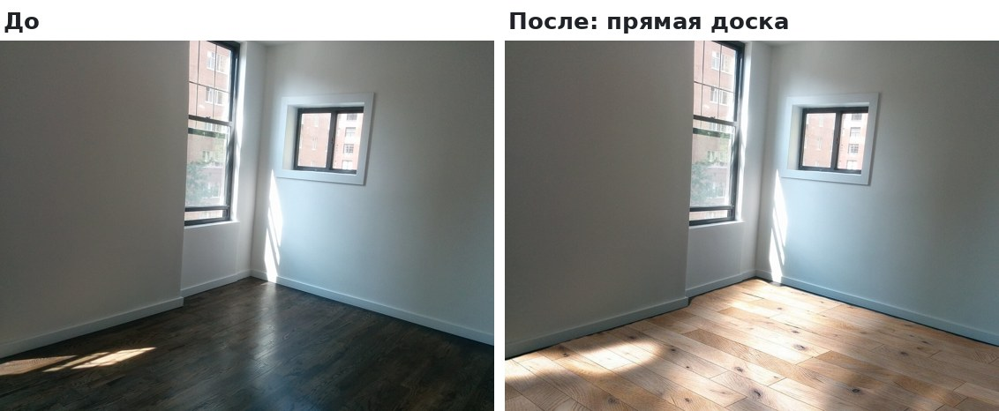
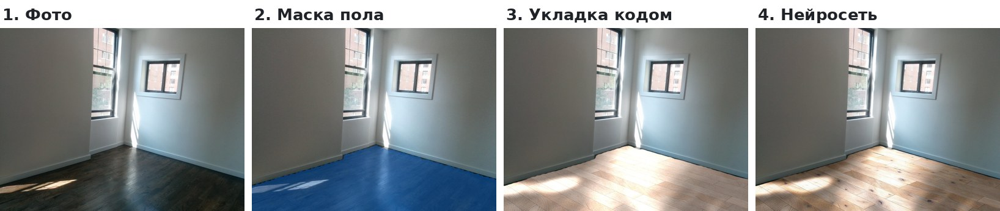
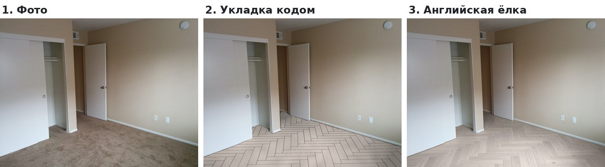
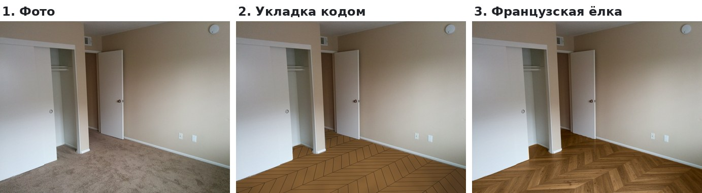
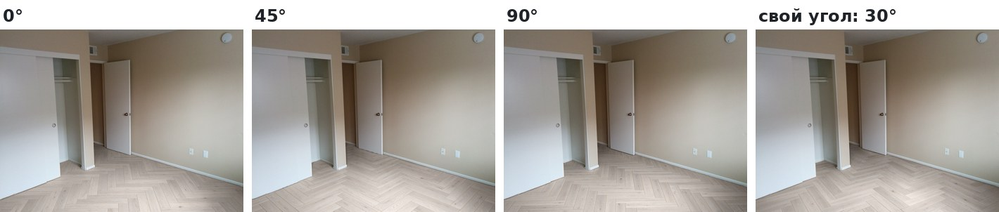
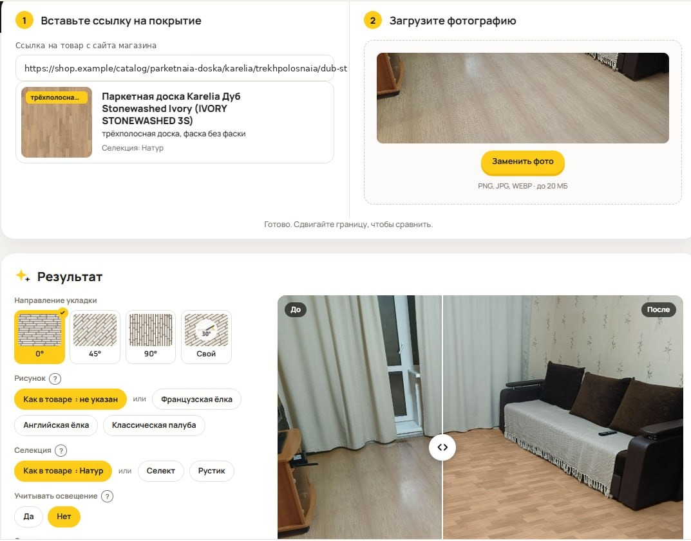
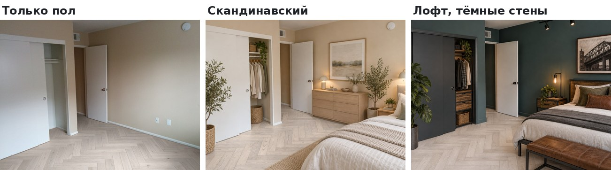

# AI-Floor — Floor Visualizer for Room Photos

**[Русская версия](README.md)**

The service shows how a chosen floor covering will look in the client's own home. The client sends a photo of the room, the manager picks a product from the catalogue, and the service lays exactly that floor on the photo: the right pattern (straight plank, English or French herringbone, modular parquet), board size, bevel and direction.

> **This is a project description.** The code is private. All images were made on stock room photos; no client photos are used.

## Problem

- Before buying, clients can't picture how the floor will look in their own room; catalogue photos show someone else's interior and lighting.
- So decisions get postponed: samples, showroom visits, "I'll think about it".
- Typical generative "try-ons" look nice but are inaccurate: they mix up the pattern, change board size and lose the herringbone. To sell a specific product the client must see that exact product.

## How it works

**1. Precise layout (main path, about ₽1.5 per image)**
1. A local segmentation model, **UperNet ConvNeXt Tiny** (ADE20K classes, ONNX, CPU), finds the floor. Rugs and carpet are handled separately.
2. Code estimates perspective and the wall line from the mask and lays out boards using the product card: width, length, stagger, bevel, pattern, rotation. This is pure geometry, so the pattern and board size are always correct.
3. The image model **Seedream 5 Flash** takes this draft and the product photo and makes the surface realistic — wood texture, knots, light, shadows, reflections — without moving the boards.

**2. Direct rendering (fallback, about ₽2.5)**
When the mask is inaccurate (pieces of the old floor remain, or the floor spills onto furniture), a stronger model, **GPT Image**, draws the floor itself from the room photo, product photo and our board scheme. Modular parquet and three-strip boards also go this way: Seedream can't hold a fine module grid.

## Complex patterns and laying direction

What clients care about most is the pattern itself — English or French herringbone, modular parquet — and which way it runs, because that changes how the room looks. That is why the pattern is built by code, not by the model.

Direction is one click: 0°, 45°, 90° or a custom angle. Code recomputes the pattern in the room's perspective; the model only makes it realistic. We haven't seen this in other floor visualizers.

## Interface

The manager pastes a product link and uploads a room photo. The service reads the pattern, bevel and grade from the product card; they can be changed along with the laying direction and lighting. The result is compared with the original using a before/after slider.

## Design ideas

Once the floor is chosen, the client can quickly try an interior: pick a style (Scandinavian, loft, Japandi, classic and 9 more) and a wall colour. The service restyles the room around the chosen floor; the floor stays the same product and is not paid for twice.

## Improving accuracy

The weak point is the floor mask: it decides whether the cheap path works. Instead of switching to the expensive model everywhere, we collect our own data:

- A Paint-like mask editor is built in: brush in floor the model missed or erase what it got wrong.
- Every correction is saved as a "photo + correct mask" pair, next to what the model found on its own.
- The model will be fine-tuned on this set for real apartment photos. A better mask means the ₽1.5 path works more often and fewer images are rejected.

## Results

- The client sees the exact product in the right pattern in their own room.
- An image costs about ₽1.5 on the main path and about ₽2.5 on the fallback; floor plus interior design is about ₽2.6.
- From 3 to 7 November 2026 the service produced about 200 paid generations.

## Engineering decisions

| Problem | Solution |
|---|---|
| Generative models distort the pattern and board size. | Geometry is computed by code from the product card; the model only makes the surface realistic. |
| Little memory on the server. | The segmentation model is int8-quantized: 110 MB lower peak memory, masks match the original model by 99.6–99.9%. The model is unloaded after use; images are rendered one at a time. |
| Generation cost. | Cheap model by default, expensive only where the cheap one fails. Budget limit, daily tokens per visitor, a log of every generation; an already rendered floor is never paid for twice. |
| Inaccurate masks on hard photos. | A stronger fallback model now, labelled data for fine-tuning later. |
| Managers need oversight. | Result gallery, share links for clients, image ratings, website chat to Telegram, and a daily report on usage, spend and errors. |

## Status

Currently an internal tool: managers use it when talking to a client in person. Next step: a try-on button on every product page of the website so clients can try floors themselves.

## Stack

Python, FastAPI, ONNX Runtime (UperNet ConvNeXt Tiny, ADE20K, int8), NumPy, Pillow, OpenRouter Image API (Seedream 5 Flash, GPT Image), nginx, systemd.

## My role

The idea came from sales: clients lacked a clear picture of how a floor would look at home. I framed the problem, compared generation and segmentation models on the same photos for quality and cost, chose the hybrid "geometry by code + realism by the model" approach, designed and launched the service and set up cost control. I'm now collecting data to fine-tune the model and preparing the website launch.
