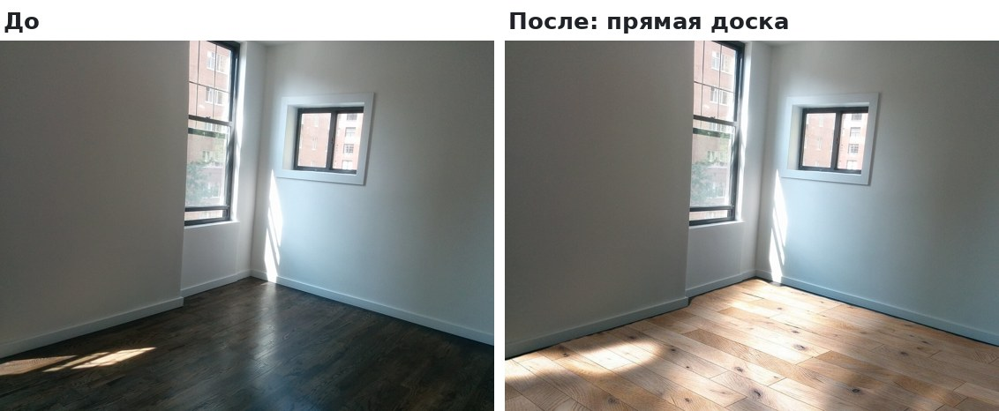
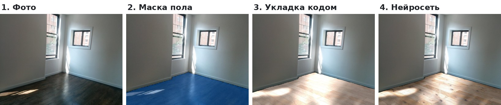
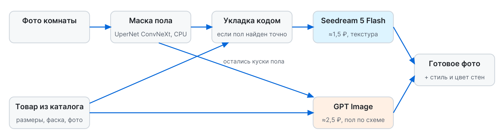
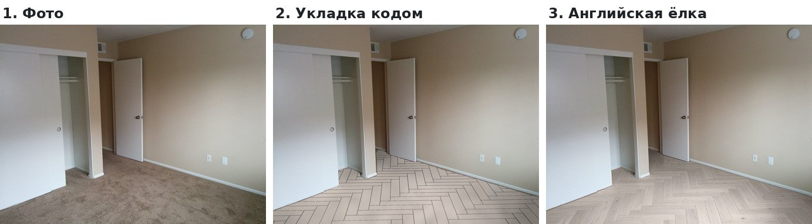
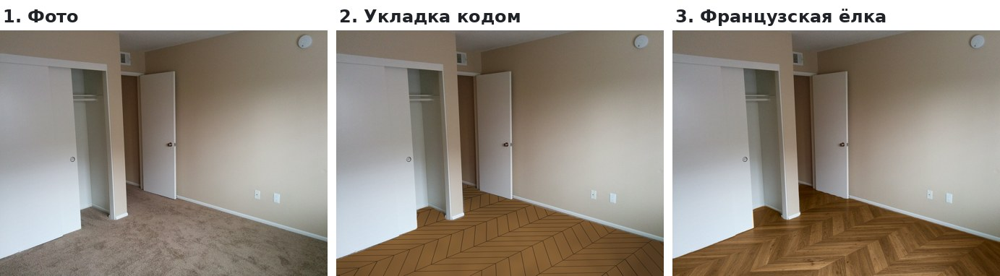
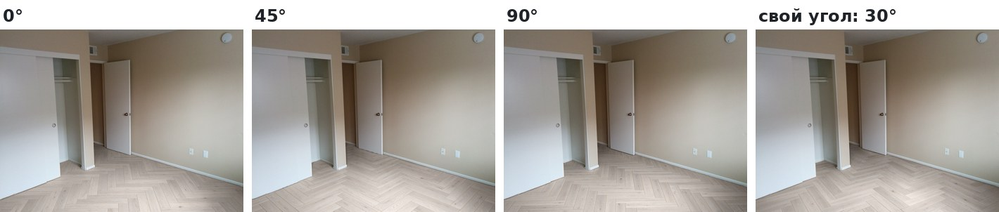
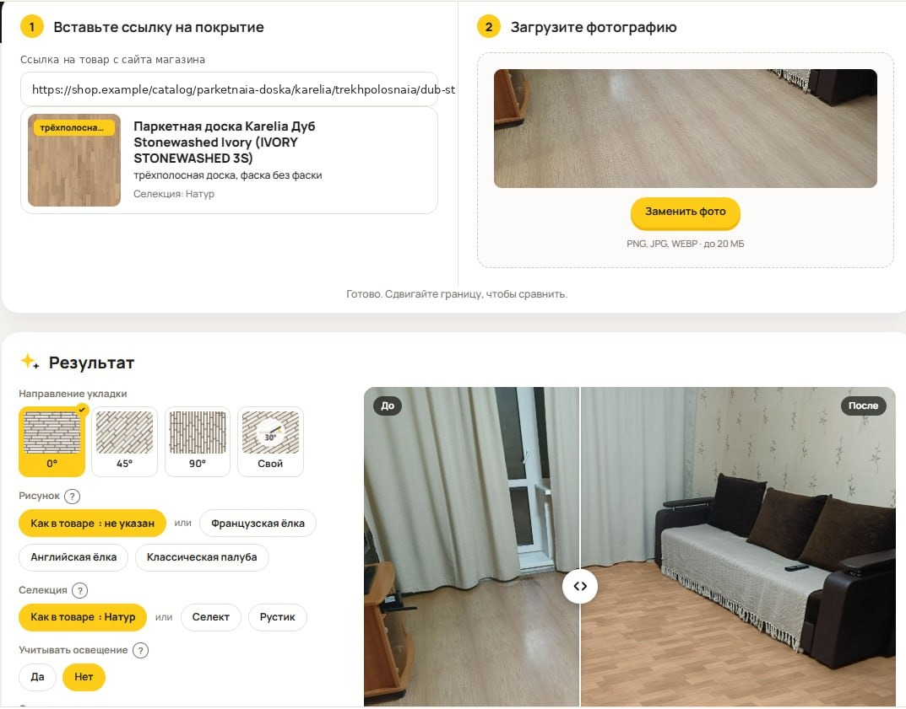
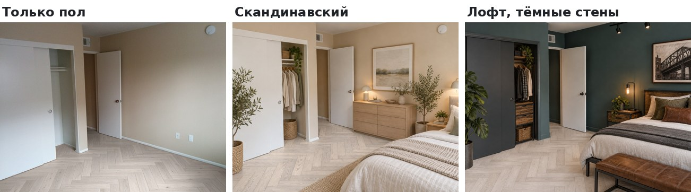
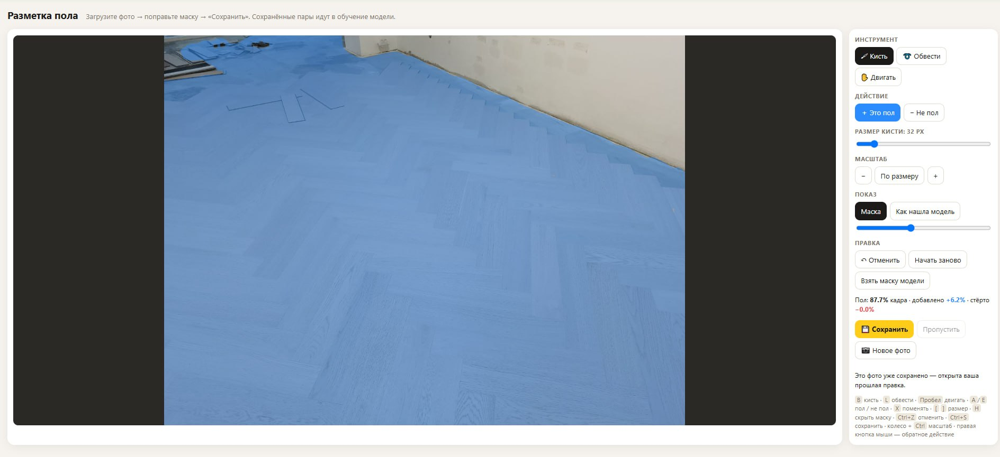

# AI-Floor — примерка пола на фото комнаты

**[English version](README.en.md)**

Сервис показывает, как выбранное покрытие будет выглядеть в квартире клиента. Клиент присылает фото комнаты, менеджер выбирает товар из каталога. Сервис кладёт на фото именно этот пол: в нужной укладке (прямая доска, английская или французская ёлка, модульный паркет), с правильным размером доски, фаской и направлением.

> **Это описание проекта.** Код закрыт. Здесь задача, подход, архитектура и результаты. Все картинки сделаны на стоковых фото комнат, фото клиентов не используются.

## Чем отличается от «закинуть фото в нейросеть»

Универсальная нейросеть нарисует «какой-то деревянный пол». Покупателю конкретного артикула этого мало: ему важно понять, как будет выглядеть именно этот товар, в этой укладке и в этой селекции.

- **Направление укладки.** Клиент выбирает 0°, 45°, 90° или свой угол и видит, как рисунок ляжет относительно стен и окна. Рисунок строит код по размерам доски, поэтому ёлка остаётся ёлкой, а размер доски — настоящим.
- **Селекция: натур, селект, рустик.** Одна и та же инженерная или паркетная доска бывает дороже и без сучков или дешевле и с сучками. У производителя часто есть фото только одной селекции, обычно натур, и клиент не понимает, чем рустик отличается от селекта. Сервис показывает любую селекцию прямо на его полу, и выбор между ценой и видом становится понятным.
- **Сложные рисунки.** Английская и французская ёлка, модульный паркет, трёхполосная доска — то, что сложнее всего представить по фото в каталоге.
- **Home staging в один клик.** Можно увидеть свой пол в готовом интерьере: выбрать стиль и цвет стен кнопками, без промптов. Для клиента это бесплатный home staging своей квартиры в пару кликов.

## Задача

- Перед покупкой клиент не понимает, как пол будет смотреться именно у него. Фото в карточке товара сняты в чужом интерьере и при другом свете.
- Из-за этого решение откладывается, клиент просит образцы, едет в шоурум или уходит думать.
- Обычные «нейросетевые» примерки рисуют красиво, но неточно: путают укладку, меняют размер доски, теряют рисунок ёлки. Для продажи конкретного артикула это не годится: клиент должен видеть именно этот товар.

## Как работает

Сервис сочетает два подхода. Основной точнее и дешевле, запасной надёжнее на сложных фото.

**1. Точная укладка (основной путь, около 1,5 ₽ за картинку)**

1. Локальная модель сегментации **UperNet ConvNeXt Tiny** (классы ADE20K, ONNX, CPU) находит пол на фото. Ковёр и ковролин распознаются отдельно.
2. Код по маске оценивает перспективу и линию стены и раскладывает доски по размерам из карточки товара: ширина, длина, разбежка, фаска, рисунок укладки, угол поворота. Это чистая геометрия, без нейросети, поэтому рисунок ёлки и размер доски всегда верные.
3. Модель генерации изображений **Seedream 5 Flash** получает эту заготовку и фото товара и делает поверхность реалистичной: текстура дерева, сучки, свет, тени и отражения. Расположение досок она не меняет.

**2. Прямая отрисовка (запасной путь, около 2,5 ₽)**

Локальная модель не всегда находит пол точно: на фото остаются куски старого покрытия или, наоборот, пол заходит на мебель. В этом случае более дорогая модель **GPT Image** рисует пол сама по фото комнаты, фото товара и нашей схеме досок. Так же рисуются модульный паркет и трёхполосная доска: мелкую сетку модулей Seedream не удерживает.

## Сложные рисунки и направление укладки

Больше всего клиенту важно увидеть не «дерево на полу», а именно рисунок: английскую или французскую ёлку, модульный паркет. И то, в какую сторону он смотрит: от этого зависит, как выглядит комната. Поэтому рисунок строит код, а не нейросеть.

Направление выбирается одной кнопкой: 0°, 45°, 90° или свой угол. Рисунок пересчитывается кодом в перспективе комнаты, нейросеть только делает его реалистичным. В известных нам примерках пола такой возможности нет.

## Интерфейс

Менеджер вставляет ссылку на товар и загружает фото комнаты. Сервис сам читает из карточки рисунок, фаску и селекцию; их можно поменять вместе с направлением укладки и учётом освещения. Результат сравнивается с исходным фото ползунком «до / после».

## Подбор дизайна

Когда пол выбран, можно быстро прикинуть интерьер: выбрать стиль (скандинавский, лофт, японди, классика и ещё 9) и цвет стен. Сервис меняет обстановку вокруг уже выбранного пола, сам пол остаётся тем же товаром. Пол, нарисованный в этом направлении раньше, повторно не оплачивается.

## Как улучшаем точность

Самое слабое место — маска пола. От неё зависит, сработает ли дешёвый путь. Поэтому вместо того, чтобы сразу переходить на дорогую модель, мы набираем свои данные:

- В сервис встроен редактор разметки «пол / не пол», как в Paint: кисть и лассо, режимы «Это пол» и «Не пол», размер кисти, масштаб, отмена, горячие клавиши. Можно переключиться на «как нашла модель» и сравнить, а внизу видно, какая доля кадра — пол и сколько добавлено или стёрто вручную.
- Каждая правка сохраняется парой «фото + верная маска». Рядом хранится то, что модель нашла сама, чтобы видеть разницу «было / стало».

- На этом наборе модель будет дообучаться под реальные фото квартир. Чем точнее маска, тем чаще срабатывает путь за 1,5 ₽ вместо 2,5 ₽ и тем меньше брака.

## Результат

- Клиент видит в своей комнате конкретный артикул в нужной укладке, а не «похожий пол».
- Картинка стоит около 1,5 ₽ на основном пути и около 2,5 ₽ на запасном; пол вместе с дизайном интерьера — около 2,6 ₽.
- С 3 по 7 ноября 2026 года сервис сделал около 200 платных генераций.

## Инженерные решения

| Проблема | Решение |
|---|---|
| Генеративные модели искажают укладку и размер доски. | Геометрию считает код по данным карточки товара, нейросеть отвечает только за реалистичность поверхности. |
| Мало памяти на сервере. | Модель сегментации квантована в int8: пик памяти на 110 МБ ниже, маска совпадает с исходной моделью на 99,6–99,9%. Модель выгружается из памяти после поиска пола, картинки считаются по одной. |
| Расходы на генерацию. | Дешёвая модель по умолчанию, дорогая только там, где дешёвая не справляется. Лимит бюджета, дневные токены на посетителя, журнал каждой генерации. Уже нарисованный пол повторно не оплачивается. |
| Неточная маска на сложных фото. | Запасной путь через более сильную модель сейчас и сбор размеченных данных для дообучения на будущее. |
| Менеджеру нужен контроль. | Галерея результатов, ссылка «поделиться» для клиента, оценки картинок, чат с сайта в Telegram и ежедневный отчёт: кто пользовался, сколько генераций и расходов, какие были ошибки. |

## Статус

Сейчас сервис работает как внутренний инструмент: менеджер использует его при личном общении с клиентом. Следующий шаг — кнопка примерки в каждой карточке товара на сайте, чтобы клиент мог примерить пол сам.

## Стек

Python, FastAPI, ONNX Runtime (UperNet ConvNeXt Tiny, ADE20K, int8), NumPy, Pillow, OpenRouter Image API (Seedream 5 Flash, GPT Image), nginx, systemd.

## Моя роль

Идея выросла из продаж: клиентам не хватало понимания, как покрытие будет выглядеть у них дома. Я сформулировал задачу, сравнил модели генерации и сегментации на одних и тех же фото по качеству и цене, выбрал гибридный подход «геометрия кодом + реализм нейросетью», спроектировал и внедрил сервис и настроил контроль расходов. Сейчас собираю данные для дообучения модели и готовлю запуск на сайте.
